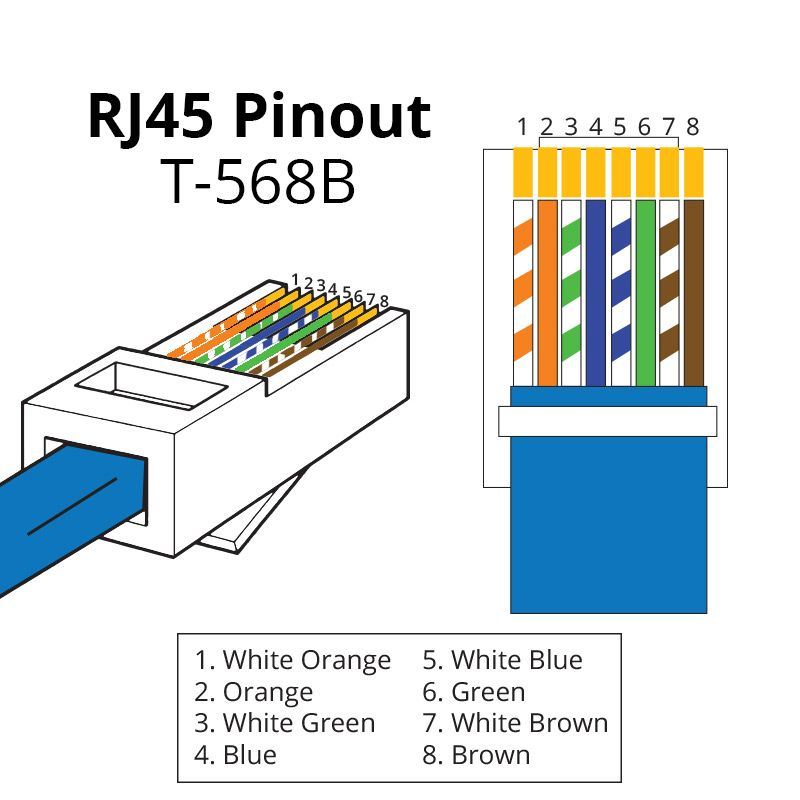
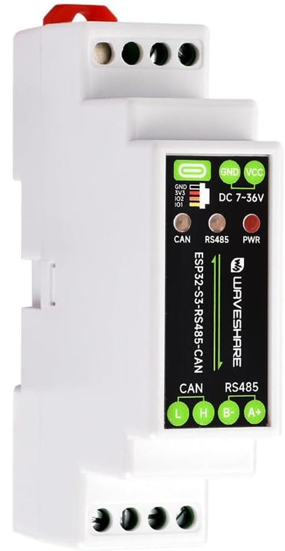

# Atlantic Shogun ZC S4 Modbus Controller

This project turns a **Waveshare ESP32-S3-RS485-CAN** board into a standalone controller and gateway for an **Atlantic Shogun ZC 1.1 / S4 160** zone-control system.

The ESP32 talks to the Shogun controller through **Modbus RTU over RS485**, serves a local web interface and integrates the system into **Home Assistant through MQTT**. The firmware is a native PlatformIO / Arduino project, not an ESPHome device.

## Contents

- [Features](#features)
- [Architecture](#architecture)
- [Hardware](#hardware)
- [Configuring the Shogun](#configuring-the-shogun)
- [Building and flashing](#building-and-flashing)
- [First start and configuration](#first-start-and-configuration)
- [Web dashboard](#web-dashboard)
- [Home Assistant and MQTT](#home-assistant-and-mqtt)
- [Estimated power and energy](#estimated-power-and-energy)
- [Security notes](#security-notes)
- [Troubleshooting](#troubleshooting)
- [Project layout](#project-layout)

## Features

**Shogun control**

- Modbus RTU at **19200 baud, 8E2**, slave address **1**.
- Detects the number of configured zones (up to 8). For each zone it reads the ambient temperature, the active setpoint, the Comfort, Eco and manual setpoints with their limits, the control mode, the power state, the damper opening, the schedule program and the zone name.
- Zone control: power on / off, schedule or manual mode, setpoints and schedule program assignment. The sensor lock and the setpoint limits of a zone are available through MQTT.
- Building control: heating, cooling, dehumidification or off, and the automatic heating / cooling changeover.
- Editing of the four weekly schedule programs (7 days × 6 time slots).
- Central fault status (read only).
- Estimated electrical power and energy (a model, not a measurement).

**Web interface**

- Dashboard with the building state, the zones and the schedules, served from LittleFS.
- Controls that cannot be used in the current configuration (for example with the building mode off) are disabled.
- Configuration page and action endpoints protected by a password outside the setup mode.

**MQTT and Home Assistant**

- State, command, availability and debug topics under `shogun/<unique_id>/`.
- MQTT Discovery for the thermostats, sensors, numbers, selects and switches of every zone and for the global controls.
- Adjustable debug verbosity, including a trace of every Modbus request.

**Device**

- Over-the-air firmware update.
- Joins the access point with the best signal when several share the Wi-Fi name.
- Setup access point on first start, as a fallback when Wi-Fi or MQTT cannot be reached, and a factory reset with the BOOT button.

## Architecture

```text
Atlantic Shogun ZC S4 160
        │
        │ Modbus RTU / RS485
        │ 19200 8E2, slave 1
        ▼
Waveshare ESP32-S3-RS485-CAN
        │
        ├── Local web interface (LittleFS)
        │
        └── MQTT
              │
              ▼
        Home Assistant
```

The firmware reports its runtime and diagnostic information through MQTT. The serial output is not needed in normal operation.

## Hardware

### What you need

- A **Waveshare ESP32-S3-RS485-CAN** board.
- A shielded twisted-pair cable, 3 m at most, with an RJ45 plug for the Shogun (a T568B Ethernet patch cable cut at one end works).
- A USB cable for the first flash.

### Wiring

The Shogun exchanges Modbus RTU / RS485 data on the RJ45 connector of its controller. The communication signals are on **pins 3 and 6**, which are the white / green and green wires of a T568B cable. Check the pin numbers from left to right with the copper contacts facing up.



| RJ45 pin | T568B wire | Shogun signal | Waveshare terminal |
| :---: | :--- | :---: | :---: |
| 1 | 🟧 White / Orange | not used | – |
| 2 | 🟧 Orange | not used | – |
| **3** | 🟩 **White / Green** | **RS485 A (+)** | **A+** |
| 4 | 🟦 Blue | not used | – |
| 5 | 🟦 White / Blue | not used | – |
| **6** | 🟩 **Green** | **RS485 B (−)** | **B−** |
| 7 | 🟫 White / Brown | not documented | – |
| 8 | 🟫 Brown | not documented | – |

1. Cut the outer jacket of the cable and isolate the **white / green** (pin 3) and **green** (pin 6) wires.
2. Screw them into the green terminal block of the Waveshare board: white / green to **A+**, green to **B−**.
3. Plug the RJ45 connector into the Shogun controller.



Notes:

- Atlantic's documentation (`docs/gtb-shogun.pdf`, section 2.2) specifies a **shielded twisted pair**, a cable of **3 m at most**, and a shield **connected to earth at one end only**.
- If the Shogun does not answer, swap A+ and B−.
- The Atlantic documentation uses only pins 3 and 6. Pins 7 and 8 are not documented, so do not connect them to the board unless you have checked with a multimeter that they are a ground reference. A common ground between the two devices is optional.

### ESP32-S3 pins

| Function | Pin |
| --- | --- |
| UART RX | GPIO 18 |
| UART TX | GPIO 17 |
| RS485 direction (DE / RE) | GPIO 21 |
| BOOT button (factory reset, see below) | GPIO 0 |

The RS485 direction is driven by the firmware: GPIO 21 is set high around every Modbus transmission. Nothing needs to be configured for it. For a different board, change the pins in `src/main.cpp` (`WAVESHARE_RS485_RX`, `WAVESHARE_RS485_TX`, `BUTTON_BOOT_PIN`) and `RS485_EN_PIN` in `src/Shogun.cpp`.

## Configuring the Shogun

The firmware is built for **19200 baud, 8 data bits, even parity, 2 stop bits and slave address 1** (`RS485_BAUD` and `SHOGUN_ID` in `src/Shogun.cpp`). The slave address is not detected automatically.

The factory baud rate of the Shogun is **9600**, so set the Shogun to **19200** (or change `RS485_BAUD` in the firmware to match) in the specialist mode of the controller menu, under the Modbus RS485 communication settings. Sections 2.4.1 to 2.4.3 of `docs/gtb-shogun.pdf` describe how to reach them.

## Building and flashing

The project defines two PlatformIO environments:

| Environment | Use |
| --- | --- |
| `waveshare_esp32s3_shogun` (default) | build and USB upload |
| `waveshare_esp32s3_shogun_ota` | over-the-air firmware upload |

The build uses the [pioarduino](https://github.com/pioarduino/platform-espressif32) platform, the `esp32-s3-devkitc-1` board definition and the libraries *ModbusMaster* and *PubSubClient*, which PlatformIO installs by itself. The flash holds two 1.5 MB application slots for OTA, the configuration storage and a 576 KB LittleFS partition for the web files (`partitions.csv`).

### Build

```bash
pio run
```

### First flash over USB

The web interface lives in `data/` and is stored in LittleFS, so **the firmware and the filesystem are uploaded separately**:

```bash
pio run -e waveshare_esp32s3_shogun -t upload
pio run -e waveshare_esp32s3_shogun -t uploadfs
```

`uploadfs` sends the content of `data/` without rebuilding the firmware. Run it again whenever a file of `data/` changes, because a firmware update does not touch the web files.

To start from a blank flash:

```bash
pio run -e waveshare_esp32s3_shogun -t erase
pio run -e waveshare_esp32s3_shogun -t upload
pio run -e waveshare_esp32s3_shogun -t uploadfs
```

`erase` wipes the **whole flash**: the saved configuration (Wi-Fi, MQTT, passwords, power settings) and the estimated-energy counter are lost, and the device starts in setup mode.

### OTA firmware update

The OTA environment uses PlatformIO's `espota` protocol. It reads the password from the `OTA_PASSWORD` environment variable, which must match the **OTA password saved in the configuration page**. The device is reached by its mDNS name, which is its **device name** (`<device-name>.local`), or by its IP address.

Linux / macOS:

```bash
export OTA_PASSWORD="your_ota_password"
pio run -e waveshare_esp32s3_shogun_ota -t upload --upload-port <device-name>.local
```

PowerShell:

```powershell
$env:OTA_PASSWORD="your_ota_password"
pio run -e waveshare_esp32s3_shogun_ota -t upload --upload-port <device-name>.local
```

Command Prompt:

```cmd
set OTA_PASSWORD=your_ota_password
pio run -e waveshare_esp32s3_shogun_ota -t upload --upload-port <device-name>.local
```

The OTA environment uploads the firmware only. The web files (`data/`) are not covered, they are updated over USB with `uploadfs`.

### Recommended update procedures

Over USB:

```bash
pio run -e waveshare_esp32s3_shogun -t clean
pio run -e waveshare_esp32s3_shogun -t upload
pio run -e waveshare_esp32s3_shogun -t uploadfs
```

Firmware only, over the air: the OTA command above.

### Serial monitor and useful commands

```bash
pio device monitor -b 115200     # serial monitor, useful for startup and upload problems
pio device list                  # detected serial devices
pio project config               # resolved PlatformIO configuration
pio run -t clean                 # clean the build directory
```

## First start and configuration

1. After flashing, with no saved configuration, the device opens its own Wi-Fi network **`shogun-<id>`** (`<id>` is derived from the MAC address of the board). This network has **no password**.
2. Connect to it and open **http://192.168.1.1/**: the configuration page is shown.
3. Fill in the form and save. The device restarts and joins your network.

| Field | Meaning |
| --- | --- |
| Wi-Fi SSID and password | the network to join (the access point with the best signal is used when several share the name) |
| MQTT server, port, user and password | the broker used by Home Assistant (the port is usually `1883`) |
| Device name | name of the device, its mDNS name (`<device-name>.local`) and its name in Home Assistant |
| OTA password (required) | password of the OTA update and of the web administration, see [security notes](#security-notes) |
| Heating and cooling electrical power | nominal power used by the [power estimate](#estimated-power-and-energy) (defaults 790 W and 600 W) |

Once connected, the dashboard is at `http://<device-name>.local/` or at the IP address given by your router. The configuration page (`/config`) stays available there, after a login.

**Setup access point as a fallback.** If the device cannot join Wi-Fi or reach the MQTT broker within 60 seconds, or after a crash, it restarts into the same setup network. The setup network then stays open for 5 minutes, after which the device restarts and retries with the saved configuration.

**Factory reset.** Pressing the **BOOT button** (GPIO 0) while the firmware is running **erases the saved configuration immediately** (there is no long-press delay) and restarts in setup mode. The estimated-energy counter is kept.

## Web dashboard

The dashboard (`/`) shows, and lets you change:

- **System:** date and time, central fault, number of zones, building mode (heating, cooling, dehumidification, off), automatic heating / cooling changeover and outdoor temperature.
- **Zones:** for every zone, the ambient temperature, the **Active setpoint** (the field changes the setpoint in use: the manual setpoint in manual mode, the Comfort or Eco setpoint in schedule mode, the label under it tells which), the **Comfort / Eco** setpoints, the **Power** button, the **Control mode** (schedule or manual) and the **Schedule** program. The **All zones** form sets Comfort and Eco on every zone.
- **Schedules:** the four programs, each as a table of 7 days × 6 time slots (Comfort 1, Eco 1, Comfort 2, Eco 2, Comfort 3, Eco 3). A slot is edited in place and emptied with ×.

With the building mode off, the Shogun is in stand-by (frost protection only) and the zone controls are disabled. A zone that is off has no editable Active setpoint.

## Home Assistant and MQTT

With MQTT configured, the device appears in Home Assistant through MQTT Discovery. It creates a thermostat, the temperature, damper and program sensors and the Comfort, Eco, Active setpoint, manual setpoint and limits numbers, the control mode and schedule program selects and the power and sensor lock switches for every zone, plus the building mode, the automatic changeover and the estimated power and energy.

The topics, the payloads, the commands, the debug levels and the Modbus register reference are described in [`MQTT_HOME_ASSISTANT.md`](MQTT_HOME_ASSISTANT.md).

For troubleshooting, the debug topic `shogun/<unique_id>/debug` can show every Modbus request and response: send `trace` to `shogun/<unique_id>/debug/level/set`. The default level only reports errors and warnings.

## Estimated power and energy

The Shogun gives no electrical measurement, so the power is **estimated** from the zones and the outdoor temperature, applied to the nominal heating and cooling power of the configuration page. The energy is the integral of this power, kept in flash across reboots. The model and its calibration are described in [`MQTT_HOME_ASSISTANT.md`](MQTT_HOME_ASSISTANT.md#estimated-electrical-power-and-energy).

It is meant to give an order of magnitude and to feed the Home Assistant Energy dashboard, not to replace a meter.

## Security notes

- In normal operation, the dashboard (`/`) and its data (`/api/status`) are readable **without a login** by anyone on the network. The configuration page, the actions (`/action`) and the restart (`/restart`) need an HTTP login: user **`admin`** and the **OTA password**.
- The OTA password is required in the configuration form. It protects both the OTA update and the web administration, so choose a strong one.
- The setup access point is open and its pages need no login. It is only active on first start and for 5 minutes after a failure.
- The project has no HTTPS: keep the device on a trusted network.

## Troubleshooting

| Symptom | What to check |
| --- | --- |
| No zones or no data | Wiring of A+ and B− (swap them), Shogun set to 19200 baud, even parity, 2 stop bits and address 1, cable length and shield. Set the debug level to `trace` and look at the `modbus_response` events: a `result` other than `0x0` is a communication error. |
| Blank or unstyled dashboard | The filesystem was not uploaded: run `uploadfs`. |
| Entities missing in Home Assistant | The MQTT settings, and the broker. Discovery is published once after each boot, when MQTT is connected and all zone names have been read: restart the device after a zone has been renamed. |
| Login asked on the configuration page | User `admin`, password = OTA password. If it is lost, press the BOOT button to reset the configuration. |
| Device keeps restarting into the setup network | It cannot join Wi-Fi or reach the MQTT broker within 60 seconds: check the saved settings. |
| OTA upload fails | `OTA_PASSWORD` must match the OTA password of the configuration page, and `--upload-port` must be the device name (`<device-name>.local`) or its IP address. |

## Project layout

| Path | Content |
| --- | --- |
| `src/Shogun.cpp`, `src/Shogun.h` | Modbus polling, web server, MQTT and Home Assistant discovery |
| `src/Json.h` | small JSON writers used for every JSON text of the firmware |
| `src/Config.cpp`, `src/Config.h` | configuration stored in flash |
| `src/main.cpp` | entry point and pin assignment |
| `data/` | web interface stored in LittleFS (`index.html`, `config.html`, `app.js`, `style.css`) |
| `docs/gtb-shogun.pdf` | Atlantic technical reference (Modbus registers, wiring) |
| `MQTT_HOME_ASSISTANT.md` | MQTT topics, Home Assistant entities, Modbus registers |
| `platformio.ini`, `partitions.csv` | build and flash layout |
